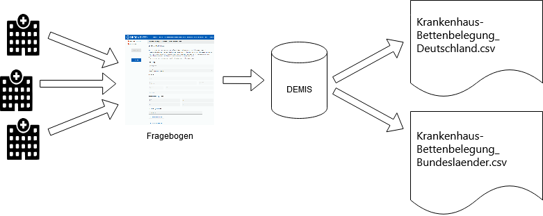

<!-- HEADER_START: {"lang": "de"} -->


Dokumentation  

# Krankenhaus-Bettenbelegung in Deutschland

<br> 
<br> 
<br> 

[**Robert Koch-Institut**](http://www.rki.de/)

<br> 

**Beitragende**   
[Philip Oedi](https://orcid.org/0009-0001-7112-505X)&sup1;, Katarina Birghan&sup2;, & [Michaela Diercke](https://orcid.org/0000-0002-4678-1813)&sup3;

&emsp;&emsp;&sup1; [Robert Koch-Institut](http://www.rki.de/)  
&emsp;&emsp;&sup2; [Robert Koch-Institut](http://www.rki.de/) | [Fachgebiet MF 2](https://www.rki.de/mf2)  
&emsp;&emsp;&sup3; [Robert Koch-Institut](http://www.rki.de/) | [Fachgebiet 32](https://www.rki.de/fg32)

<br> 

**Zitieren**  
<!-- CITATION_START: {"citation_style": "apa", "markdown_style": "plain"} -->
Robert Koch-Institut. (2026). Krankenhaus-Bettenbelegung in Deutschland [Data set]. Zenodo. [https://doi.org/10.5281/zenodo.24531753](https://doi.org/10.5281/zenodo.24531753)
<!-- CITATION_END -->


<br>

**Zusammenfassung**    
Im Datensatz "Krankenhaus-Bettenbelegung in Deutschland" des Robert Koch-Instituts werden täglich aktualisierte Informationen zur Krankenhausbettenbelegung basierend auf den Meldungen nach dem Infektionsschutzgesetz (IfSG) bereitgestellt. Der Datensatz umfasst die Anzahl der betreibbaren, der belegten sowie der verfügbaren Betten auf Normalstationen für Erwachsene und Kinder deutschlandweit und auf Ebene der Bundesländer. Zusätzlich wird der Anteil der belegten sowie der verfügbaren Betten an den betreibbaren Betten bereitgestellt. Ziel ist es, frühzeitig eine Überlastung auf Normalstationen in deutschen Krankenhäusern auf Stadt-, Kreis- und Landesebene zu erkennen und gegensteuern zu können.

<br>

**Inhaltsverzeichnis**  

<!-- TOC_START: {"heading_depth": 2} -->
  - [Administrative und organisatorische Angaben](#administrative-und-organisatorische-angaben)  
  - [Entstehungskontext](#entstehungskontext)  
  - [Aufbau und Inhalt des Datensatzes](#aufbau-und-inhalt-des-datensatzes)  
  - [Hinweise zur Nachnutzung der Daten](#hinweise-zur-nachnutzung-der-daten)  
<!-- TOC_END -->

<br>

<!-- HEADER_END -->

# Informationen zum Datensatz und Entstehungskontext

Krankenhäuser haben die Verpflichtung, Daten über ihre Kapazitäten auf Normalstationen für Kinder und Erwachsene (ausgenommen psychiatrische Stationen) an das Robert Koch-Institut zu melden ([§ 13 Absatz 7 des Infektionsschutzgesetzes](https://www.gesetze-im-internet.de/ifsg/index.html), IfSG). Diese Verpflichtung gilt für Krankenhäuser, die akute Versorgung mit Notaufnahmen oder Fachkliniken anbieten und unter den Entgeltbereich "Diagnosis Related Groups" (DRG) gemäß [§ 17b](https://www.gesetze-im-internet.de/khg/__17b.html) des Krankenhausfinanzierungsgesetzes (KHG) fallen. Das Ziel der Datenerhebung ist es, frühzeitig eine Überlastung auf Normalstationen in deutschen Krankenhäusern auf Stadt-, Kreis- und Landesebene zu erkennen und gegensteuern zu können. Diese Daten werden dem RKI über das Deutsche elektronische Melde- und Informationssystem für den Infektionsschutz (DEMIS) gemeldet und im vorliegenden Datensatz bereitgestellt.

## Administrative und organisatorische Angaben

Im Datensatz "Krankenhaus-Bettenbelegung in Deutschland" werden Daten zur aktuellen Krankenhausbettenbelegung in Deutschland als Open Data bereitgestellt. Das [Fachgebiet 32 | Surveillance und elektronisches Melde- und Informationssystem (DEMIS) | ÖGD-Kontaktstelle](https://www.rki.de/fg32)  ist verantwortlich für die fachlichen Anforderungen, Standardisierung und konzeptionelle Weiterentwicklung des Meldesystems gemäß IfSG.  

Zuständig für den Betrieb des Meldesystems und die Verarbeitung und Aufbereitung der im Meldesystem vorliegenden Rohdaten ist das [Fachgebiet IT4 | Software­architektur und -entwicklung](https://www.rki.de/it4) des RKI.  

Die Veröffentlichung der Daten, die Datenkuration sowie das Qualitätsmanagement der (Meta-)Daten erfolgen durch das [Fachgebiet MF 4 | Fach- und Forschungsdatenmanagement](https://www.rki.de/mf4). Fragen zum Datenmanagement und zur Publikationsinfrastruktur können an [opendata@rki.de](mailto:OpenData@rki.de) gerichtet werden.  

## Entstehungskontext

Das Robert Koch-Institut ist ein Bundesinstitut im Geschäftsbereich des [Bundesministeriums für Gesundheit](https://www.bundesgesundheitsministerium.de/) (BMG) und ist die zentrale Einrichtung des Bundes auf den Gebieten der Krankheitsüberwachung und -prävention sowie der anwendungsorientierten biomedizinischen Forschung. Es berät die zuständigen Bundesministerien, insbesondere das BMG, und wirkt bei der Entwicklung von Normen und Standards mit. Wesentliche Aufgaben des RKI leiten sich aus dem [IfSG](https://www.gesetze-im-internet.de/ifsg/index.html) ab. Dazu gehören die Vorbeugung übertragbarer Krankheiten, die frühzeitige Erkennung und Verhinderung der Weiterverbreitung von Infektionen sowie die Erstellung von Falldefinitionen für die Bewertung von Verdachts-, Erkrankungs- oder Todesfällen und Nachweisen von Krankheitserregern (siehe [§ 4 Abs. 1 IfSG](https://www.gesetze-im-internet.de/ifsg/__4.html) und [<span class="underline">§ 11 Abs. 2 IfSG</span>](https://www.gesetze-im-internet.de/ifsg/__11.html)).

### Meldepflichten zur Bettenbelegung

Krankenhäuser, die nach § 108 SGB V zugelassen sind, sowie Privatkliniken sind verpflichtet, die Anzahl der belegten Betten auf nichtintensivmedizinischen somatischen Stationen elektronisch über das DEMIS zu melden. Diese Verpflichtung gilt seit dem 20.09.2022, als die Verordnung zur Überwachung der Krankenhauskapazität in Kraft trat. Tageskliniken, Rehabilitations- und Vorsorgeeinrichtungen müssen diese Informationen nicht melden.

Psychiatrische Einrichtungen sind gemäß [§ 13 Absatz 7 Satz 1 Nr. 1 IfSG](https://www.gesetze-im-internet.de/ifsg/__13.html) von der Meldeverpflichtung zur Bettenbelegung ausgeschlossen, da laut dieser Vorschrift nur die somatischen Behandlungskapazitäten zu melden sind.

Sogenannte "Mischkrankenhäuser" (Krankenhäuser, die psychiatrische und somatische Bereiche vorhalten) sind nach [§ 13 Absatz 7 IfSG](https://www.gesetze-im-internet.de/ifsg/__13.html) i. V. m. [§ 1 der Verordnung zur Krankenhauskapazitätssurveillance](https://www.bundesanzeiger.de/pub/publication/G88Du8FnakZStouKMtf/content/G88Du8FnakZStouKMtf/BAnz%20AT%2019.09.2022%20V1.pdf) verpflichtet, ihre somatischen Bettenkapazitäten zu melden. Psychiatrische Bettenkapazitäten sind hingegen nicht zu melden.

Gemäß der [Verordnung zur Krankenhauskapazitätssurveillance](https://www.bundesanzeiger.de/pub/publication/G88Du8FnakZStouKMtf/content/G88Du8FnakZStouKMtf/BAnz%20AT%2019.09.2022%20V1.pdf) sind gemäß § 1 Abs. 1 Krankenhäuser lediglich verpflichtet, die Anzahl belegter Betten zu melden. Für eine Bewertung der Versorgungslage ist diese Information allein leider nicht ausreichend.  Ein Teil der meldenden Krankenhäuser meldet daher freiwillig darüber hinaus noch die Anzahl der freien Betten, sodass eine Auslastung der Kapazitäten errechnet werden kann. Dieser Datensatz beinhaltet daher lediglich die Meldungen der Krankenhäuser, die sowohl die Anzahl der belegten als auch die Anzahl der freien Betten gemeldet haben.

### Deutsches Elektronisches Melde- und Informationssystem für den Infektionsschutz (DEMIS)

Mit dem Deutschen Elektronischen Melde- und Informationssystem für den Infektionsschutz (DEMIS) wird das existierende Meldesystem für Infektionskrankheiten gemäß Infektionsschutzgesetz (IfSG) weiterentwickelt. Beginnend bei den Meldenden (Krankenhäuser, Ärztinnen und Ärzte, Labore und andere) ermöglicht DEMIS eine durchgängig elektronische Informationsverarbeitung. Dadurch wird der Aufwand für die Meldenden und die zuständigen Behörden reduziert und die Informationen zu auftretenden Infektionskrankheiten liegen schneller bei den Verantwortlichen (z. B. bei den Gesundheitsämtern, den zuständigen Landesbehörden und am RKI) vor. Weiterhin werden die Zusammenarbeit der Beteiligten und der Datenaustausch unterstützt, sodass z. B. auf größere Ausbruchsgeschehen effektiver reagiert werden kann.

DEMIS setzt bei der Datenverarbeitung auf den Standard "Fast Healthcare Interoperability Resources" (FHIR) von Health Level Seven International (HL7) auf. HL7 ist ein Kommunikationsstandard und ermöglicht die Kommunikation zwischen nahezu allen Institutionen und Bereichen des Gesundheitswesens. Mit HL7 lassen sich alle wesentlichen Datenaustausch- und Kommunikationsaufgaben abwickeln und die Effizienz der Kommunikationsvorgänge verbessern.

Über die Nutzung von Profilen, Ressourcen und Referenzen können Gesundheitsdaten interoperabel zwischen verschiedenen Systemen ausgetauscht werden. Meldende können die Informationen, die elektronisch in ihren Informationssystemen vorliegen, an eine Schnittstelle (den DEMIS-Adapter) senden, der die Inhalte in das von DEMIS genutzte HL7-FHIR-Format übersetzt. Nach Übernahme der Meldungen durch den DEMIS-Adapter werden die Meldungen im zentralen System validiert. Nähere Informationen zu DEMIS sind auf der Webseite des RKI unter [www.rki.de/demis](https://www.rki.de/DE/Themen/Infektionskrankheiten/Meldewesen/DEMIS/DEMIS_inhalt.html) und in den referenzierten Fachpublikationen ([Diercke 2018](http://doi.org/10.25646/5606)) zu finden. Informationen zur DEMIS-FHIR-API und zu entsprechenden FHIR-Profilen sind unter <https://simplifier.net/demis> veröffentlicht.

> [Diercke M (2018): Deutsches Elektronisches Melde- und Informationssystem für den Infektionsschutz (DEMIS) – Entwicklungsschritte. Epid Bull(25:227–228), DOI: 10.25646/5606](http://doi.org/10.25646/5606)
> [Diercke M (2018): Vorstellung aktueller Informationen zu DEMIS. Epid Bull (9:91 – 93), DOI: 10.17886/EpiBull-2018-010](http://doi.org/10.17886/EpiBull-2018-010)

### Übermittlung der Daten an DEMIS

Die Übermittlung der Daten der Krankenhäuser erfolgt wie oben beschrieben elektronisch über DEMIS auf Basis des Fragebogens zur Krankenhausbettenbelegung. Über den Fragebogen ([StatisticInformationBedOccupancy](https://simplifier.net/rki.demis.statistic/StatisticInformationBedOccupancy/~details)) werden statistische Kennzahlen aus den Befragungen zur Krankenhausbettenbelegung gespeichert und dem RKI zur Verfügung gestellt.

Innerhalb dieses Fragebogens werden Informationsbedarfe bzgl. der aktuellen Belegung von Krankenhausbetten an einem konkreten Krankenhausstandort formuliert. Im Einzelnen sind dies:

  - Anzahl betreibbarer Betten auf Normalstationen für Erwachsene (optional)  
  - Anzahl belegter Betten auf Normalstationen für Erwachsene  
  - Anzahl betreibbarer Betten auf Normalstationen für Kinder (optional)  
  - Anzahl belegter Betten auf Normalstationen für Kinder  

Ein Krankenhaus hat üblicherweise 23 Stunden Zeit (von 12 Uhr bis 11 Uhr ME(S)Z des Folgetages), um einen entsprechenden Bericht zu versenden.



> [Profilbeschreibung](https://simplifier.net/rki.demis.statistic/StatisticInformationBedOccupancy/~overview)  
> [Beispielfragebogen](https://simplifier.net/rki.demis.statistic/statisticquestionsbedoccupancy)  
> [Implementierungsleitfaden](https://simplifier.net/guide/rki.demis.statistic/Home/resources/definitionalartifacts/questionnaires/guide-statisticquestionsbedoccupancy.guide.md?version=current)  
> [Beschreibung der Oberfläche in der DEMIS-Wissensdatenbank](https://wiki.gematik.de/pages/viewpage.action?pageId=474108419)

### Begriffsdefinitionen

Der folgende Abschnitt definiert relevante Begrifflichkeiten im Kontext dieses Anwendungsfalls:

#### Krankenhausstandort

Jedes Krankenhaus kann einen oder mehrere Krankenhausstandorte haben. Die Standorte zugelassener deutscher Krankenhäuser sind im [InEK-Standort-Verzeichnis](https://krankenhausstandorte.de/info) mit eindeutiger Standort-ID gemäß § 3 Abs. 7 Nr. 9 Standortvereinbarung registriert. In der Bettenbelegungsstatistik muss für jeden Krankenhausstandort separat gemeldet werden. Die Meldung bezieht sich nur auf Standorte, denen eine Einrichtung mit Einrichtungstyp '00' zugeordnet ist. Dies ist von Bedeutung zur Erfassung regionaler Engpässe.

#### Betreibbares Bett

Ein Bett gilt als betreibbar oder betriebsfähig, wenn entsprechend der Versorgungsstufe jeweils

  - ein vorgesehener Raum  
  - funktionsfähige Geräte  
  - Material pro Bettenplatz  
  - personelle Besetzung mit pflegerischem und ärztlichem Fachpersonal  

vorhanden sind und eingesetzt werden können.

Aufgrund dieser zahlreichen Betriebsfaktoren kann sich die Anzahl von aktuell betreibbaren Betten in einem Meldebereich kontinuierlich verändern. Diese Zahl kann auch (deutlich) von der Zahl der Planbetten im Krankenhauslandesplan abweichen. Bezugszeitpunkt in diesem Anwendungskontext ist 12:00 Uhr ME(S)Z eines Tages. Betreibbare Betten sind entweder belegt oder verfügbar.

#### Belegtes Bett

Als belegtes Bett gilt jedes betreibbare Bett, das um 12:00 Uhr ME(S)Z eines Tages belegt war.

#### Verfügbares Bett

Als verfügbares Bett gilt jedes betreibbare Bett, das um 12:00 Uhr ME(S)Z eines Tages nicht belegt war.

#### Bett auf Normalstationen

Betten auf Normalstationen sind alle Betten eines Krankenhausstandortes außer Intensivbetten und Betten für gesunde Neugeborene. Betten auf psychiatrischen Stationen, auf denen in der Regel Leistungen erbracht werden, die nicht nach Diagnosis Related Groups (DRG) abgerechnet werden (insb. Allg. Psychiatrie, Kinder- und Jugendpsychiatrie und Psychosomatik/Psychotherapie, d. h. Schlüsselnummern 2900, 3000 und 3100 nach Fachabteilungsgliederung gemäß § 301 SGB V), sind nicht zu melden.

Betten auf Normalstationen werden getrennt erfasst nach:

  - **Bett auf Normalstationen für Kinder**
    - Als entsprechende Betten zählen nur Betten auf Normalstationen, die dem
      DRG-Entgeltbereich der Pädiatrie, Kinderkardiologie, Neonatologie
      oder Kinderchirurgie (Schlüsselnummern 1000, 1100, 1200 und 1300
      nach Fachabteilungsgliederung gemäß § 301 SGB V) zugeordnet sind,
      d. h. Betten des Erwachsenenbereichs, auf denen Kinder behandelt werden,
      zählen nicht als Betten auf Normalstationen für Kinder.
  - **Bett auf Normalstationen für Erwachsene**
    - Als entsprechende Betten zählen nur Betten auf Normalstationen, die
      keine Betten auf Normalstationen für Kinder sind.

### Aufbereitung der Daten

Nach Meldung der Daten an DEMIS erfolgen am RKI Schritte zur Sicherung der Datenqualität. Dazu gehört insbesondere eine Plausibilitätsüberprüfung. Von Krankenhäusern gemeldete Daten, die

  - mehr belegte als betreibbare Betten ausweisen  
  - weniger als 8 betreibbare Betten ausweisen  
  - mehr als 10.000 betreibbare Betten ausweisen  

werden als fehlerhaft klassifiziert und nicht in den Datensatz einbezogen.

Wie oben bereits beschrieben, sind nach [<span class="underline">Verordnung zur Krankenhauskapazitätssurveillance</span>](https://www.bundesanzeiger.de/pub/publication/G88Du8FnakZStouKMtf/content/G88Du8FnakZStouKMtf/BAnz%20AT%2019.09.2022%20V1.pdf) § 1 Abs. 1 Krankenhäuser lediglich verpflichtet, die Anzahl belegter Betten zu melden. Für eine Bewertung der Versorgungslage ist diese Information allein leider nicht ausreichend.  Ein Teil der meldenden Krankenhäuser meldet daher freiwillig darüber hinaus noch die Anzahl der freien Betten, sodass eine Auslastung der Kapazitäten errechnet werden kann. Dieser Datensatz beinhaltet daher lediglich die Meldungen der Krankenhäuser, die sowohl die Anzahl der belegten als auch die Anzahl der freien Betten gemeldet haben.

## Aufbau und Inhalt des Datensatzes

Der Datensatz enthält die Anzahl der freien und belegten Krankenhausbetten in Deutschland.

Im Datensatz enthalten sind:

  - Krankenhaus-Bettenbelegung auf Bundesebene  
  - Krankenhaus-Bettenbelegung auf Bundesländerebene  
  - Lizenzdatei mit der Nutzungslizenz des Datensatzes auf Deutsch und
    Englisch  
  - Datensatzdokumentation in deutscher Sprache  
  - Metadaten zur automatisierten Weiterverarbeitung  

### Variablen und Variablenausprägungen

<!-- DATA_SCHEMA_SPECIFICATION_START: {"id": "Krankenhaus-Bettenbelegung_Deutschland", "lang": "de"} -->

Die Datei [Krankenhaus-Bettenbelegung_Deutschland.csv](https://github.com/robert-koch-institut/Krankenhaus-Bettenbelegung_in_Deutschland/blob/main/Krankenhaus-Bettenbelegung_Deutschland.csv) enthält die in der folgenden Tabelle abgebildeten Variablen und deren Ausprägungen. Ein maschinenlesbares Datenschema ist im [Data Package Standard](https://datapackage.org/) in [tableschema_Krankenhaus-Bettenbelegung_Deutschland.json](https://github.com/robert-koch-institut/Krankenhaus-Bettenbelegung_in_Deutschland/blob/main/Metadaten/schemas/tableschema_Krankenhaus-Bettenbelegung_Deutschland.json) hinterlegt:

<!-- DATA_SCHEMA_TABLE_START -->
| Variable                             | Typ     | Ausprägungen                                   | Beschreibung                                                                                                                                                                                  |
|:-------------------------------------|:--------|:-----------------------------------------------|:----------------------------------------------------------------------------------------------------------------------------------------------------------------------------------------------|
| berichtsdatum                        | date    | Format:<br>`YYYY-MM-DD`                        | Datum, für das die Bettenbelegungen und Bettenkapazitäten durch die Krankenhäuser an das RKI gemeldet wurden                                                                                  |
| betten_erwachsene_frei_<br>absolut   | integer | Werte:<br>`≥0`                                 | Anzahl der verfügbaren Betten für Erwachsene abhängig vom Berichtsdatum                                                                                                                       |
| betten_erwachsene_frei_<br>anteil    | number  | Werte:<br>`0` - `1`<br>Fehlende Werte:<br>`NA` | Anteil der verfügbaren Betten für Erwachsene in Relation zur Anzahl betreibbarer Betten für Erwachsene abhängig vom Berichtsdatum                                                             |
| betten_kinder_frei_<br>absolut       | integer | Werte:<br>`≥0`                                 | Anzahl der verfügbaren Betten für Kinder abhängig vom Berichtsdatum                                                                                                                           |
| betten_kinder_frei_anteil            | number  | Werte:<br>`0` - `1`<br>Fehlende Werte:<br>`NA` | Anteil der verfügbaren Betten für Kinder in Relation zur Anzahl betreibbarer Betten für Kinder abhängig vom Berichtsdatum                                                                     |
| betten_gesamt_frei_<br>absolut       | integer | Werte:<br>`≥0`                                 | Gesamtzahl verfügbarer Betten für Kinder und Erwachsene zusammengerechnet abhängig vom Berichtsdatum                                                                                          |
| betten_gesamt_frei_anteil            | number  | Werte:<br>`0` - `1`<br>Fehlende Werte:<br>`NA` | Gesamtanteil verfügbarer Betten für Kinder und Erwachsene zusammengerechnet in Relation zur Anzahl betreibbarer Betten für Kinder und Erwachsene zusammengerechnet abhängig vom Berichtsdatum |
| betten_erwachsene_belegt_<br>absolut | integer | Werte:<br>`≥0`                                 | Anzahl der belegten Betten für Erwachsene abhängig vom Berichtsdatum                                                                                                                          |
| betten_erwachsene_belegt_<br>anteil  | number  | Werte:<br>`0` - `1`<br>Fehlende Werte:<br>`NA` | Anteil der belegten Betten für Erwachsene in Relation zur Anzahl betreibbarer Betten für Erwachsene abhängig vom Berichtsdatum                                                                |
| betten_kinder_belegt_<br>absolut     | integer | Werte:<br>`≥0`                                 | Anzahl der belegten Betten für Kinder abhängig vom Berichtsdatum                                                                                                                              |
| betten_kinder_belegt_<br>anteil      | number  | Werte:<br>`0` - `1`<br>Fehlende Werte:<br>`NA` | Anteil der belegten Betten für Kinder in Relation zur Anzahl betreibbarer Betten für Kinder abhängig vom Berichtsdatum                                                                        |
| betten_gesamt_belegt_<br>absolut     | integer | Werte:<br>`≥0`                                 | Gesamtzahl belegter Betten für Kinder und Erwachsene zusammengerechnet abhängig vom Berichtsdatum                                                                                             |
| betten_gesamt_belegt_<br>anteil      | number  | Werte:<br>`0` - `1`<br>Fehlende Werte:<br>`NA` | Gesamtanteil belegter Betten für Kinder und Erwachsene zusammengerechnet in Relation zur Anzahl betreibbarer Betten für Kinder und Erwachsene zusammengerechnet abhängig vom Berichtsdatum    |
| kliniken_meldend_beide               | integer | Werte:<br>`≥0`                                 | Anzahl der Kliniken, die belegte und verfügbare Betten melden.                                                                                                                                |

<!-- DATA_SCHEMA_TABLE_END -->

<!-- DATA_SCHEMA_SPECIFICATION_END -->

<br>

<!-- DATA_SCHEMA_SPECIFICATION_START: {"id": "Krankenhaus-Bettenbelegung_Bundeslaender", "lang": "de"} -->

Die Datei [Krankenhaus-Bettenbelegung_Bundeslaender.csv](https://github.com/robert-koch-institut/Krankenhaus-Bettenbelegung_in_Deutschland/blob/main/Krankenhaus-Bettenbelegung_Bundeslaender.csv) enthält die in der folgenden Tabelle abgebildeten Variablen und deren Ausprägungen. Ein maschinenlesbares Datenschema ist im [Data Package Standard](https://datapackage.org/) in [tableschema_Krankenhaus-Bettenbelegung_Bundeslaender.json](https://github.com/robert-koch-institut/Krankenhaus-Bettenbelegung_in_Deutschland/blob/main/Metadaten/schemas/tableschema_Krankenhaus-Bettenbelegung_Bundeslaender.json) hinterlegt:

<!-- DATA_SCHEMA_TABLE_START -->
| Variable                             | Typ     | Ausprägungen                                                                                       | Beschreibung                                                                                                                                                                                                                |
|:-------------------------------------|:--------|:---------------------------------------------------------------------------------------------------|:----------------------------------------------------------------------------------------------------------------------------------------------------------------------------------------------------------------------------|
| berichtsdatum                        | date    | Format:<br>`YYYY-MM-DD`                                                                            | Datum, für das die Bettenbelegungen und Bettenkapazitäten durch die Krankenhäuser an das RKI gemeldet wurden                                                                                                                |
| bundesland                           | string  | Werte:<br>`Baden-Württemberg`, `Bayern`, `Berlin`, `Brandenburg`, `Bremen`, `Hamburg`, `Hessen`, … | Name des Bundeslandes                                                                                                                                                                                                       |
| bundesland_id                        | string  | Werte:<br>`01`, `02`, `03`, `04`, `05`, `06`, `07`, …                                              | Identifikationsnummer der Bundesländer basierend auf dem Amtlichen Gemeindeschlüssel (AGS)                                                                                                                                  |
| betten_erwachsene_frei_<br>absolut   | integer | Werte:<br>`≥0`                                                                                     | Anzahl der verfügbaren Betten für Erwachsene für das zugehörige Bundesland abhängig vom Berichtsdatum                                                                                                                       |
| betten_erwachsene_frei_<br>anteil    | number  | Werte:<br>`0` - `1`<br>Fehlende Werte:<br>`NA`                                                     | Anteil der verfügbaren Betten für Erwachsene in Relation zur Anzahl betreibbarer Betten für Erwachsene für das zugehörige Bundesland abhängig vom Berichtsdatum                                                             |
| betten_kinder_frei_<br>absolut       | integer | Werte:<br>`≥0`                                                                                     | Anzahl der verfügbaren Betten für Kinder für das zugehörige Bundesland abhängig vom Berichtsdatum                                                                                                                           |
| betten_kinder_frei_anteil            | number  | Werte:<br>`0` - `1`<br>Fehlende Werte:<br>`NA`                                                     | Anteil der verfügbaren Betten für Kinder in Relation zur Anzahl betreibbarer Betten für Kinder für das zugehörige Bundesland abhängig vom Berichtsdatum                                                                     |
| betten_gesamt_frei_<br>absolut       | integer | Werte:<br>`≥0`                                                                                     | Gesamtzahl verfügbarer Betten für Kinder und Erwachsene zusammengerechnet für das zugehörige Bundesland abhängig vom Berichtsdatum                                                                                          |
| betten_gesamt_frei_anteil            | number  | Werte:<br>`0` - `1`<br>Fehlende Werte:<br>`NA`                                                     | Gesamtanteil verfügbarer Betten für Kinder und Erwachsene zusammengerechnet in Relation zur Anzahl betreibbarer Betten für Kinder und Erwachsene zusammengerechnet für das zugehörige Bundesland abhängig vom Berichtsdatum |
| betten_erwachsene_belegt_<br>absolut | integer | Werte:<br>`≥0`                                                                                     | Anzahl der belegten Betten für Erwachsene für das zugehörige Bundesland abhängig vom Berichtsdatum                                                                                                                          |
| betten_erwachsene_belegt_<br>anteil  | number  | Werte:<br>`0` - `1`<br>Fehlende Werte:<br>`NA`                                                     | Anteil der belegten Betten für Erwachsene in Relation zur Anzahl betreibbarer Betten für Erwachsene für das zugehörige Bundesland abhängig vom Berichtsdatum                                                                |
| betten_kinder_belegt_<br>absolut     | integer | Werte:<br>`≥0`                                                                                     | Anzahl der belegten Betten für Kinder für das zugehörige Bundesland abhängig vom Berichtsdatum                                                                                                                              |
| betten_kinder_belegt_<br>anteil      | number  | Werte:<br>`0` - `1`<br>Fehlende Werte:<br>`NA`                                                     | Anteil der belegten Betten für Kinder in Relation zur Anzahl betreibbarer Betten für Kinder für das zugehörige Bundesland abhängig vom Berichtsdatum                                                                        |
| betten_gesamt_belegt_<br>absolut     | integer | Werte:<br>`≥0`                                                                                     | Gesamtzahl belegter Betten für Kinder und Erwachsene zusammengerechnet für das zugehörige Bundesland abhängig vom Berichtsdatum                                                                                             |
| betten_gesamt_belegt_<br>anteil      | number  | Werte:<br>`0` - `1`<br>Fehlende Werte:<br>`NA`                                                     | Gesamtanteil belegter Betten für Kinder und Erwachsene zusammengerechnet in Relation zur Anzahl betreibbarer Betten für Kinder und Erwachsene zusammengerechnet für das zugehörige Bundesland abhängig vom Berichtsdatum    |
| kliniken_meldend_beide               | integer | Werte:<br>`≥0`                                                                                     | Anzahl der Kliniken, die belegte und verfügbare Betten melden.                                                                                                                                                              |
| kliniken_meldend_belegt              | integer | Werte:<br>`≥0`                                                                                     | Anzahl der Kliniken, die belegte Betten melden.                                                                                                                                                                             |

<!-- DATA_SCHEMA_TABLE_END -->

<!-- DATA_SCHEMA_SPECIFICATION_END -->

### Formatierung der Daten

Die Daten sind im Datensatz als kommaseparierte CSV-Dateien enthalten. Der verwendete Zeichensatz der CSV-Datei ist UTF-8. Das Trennzeichen der einzelnen Werte ist ein Komma `,`. Datumsangaben sind nach dem Standard ISO 8601 formatiert.

* Zeichensatz: UTF-8
* CSV-Trennzeichen: Komma `,`

<!-- FOOTER_START: {"lang": "de"} -->

### Metadaten  

Zur Erhöhung der Auffindbarkeit sind die bereitgestellten Daten mit Metadaten beschrieben. Über GitHub Actions werden Metadaten an die entsprechenden Plattformen verteilt. Für jede Plattform existiert eine spezifische Metadatendatei, diese sind im Metadatenordner hinterlegt:  

> [Metadaten/](https://github.com/robert-koch-institut/Krankenhaus-Bettenbelegung_in_Deutschland/tree/main/Metadaten/) 

Versionierung und DOI-Vergabe erfolgen über [Zenodo.org](https://zenodo.org). Die für den Import in Zenodo bereitgestellten Metadaten sind in der [zenodo.json](https://github.com/robert-koch-institut/Krankenhaus-Bettenbelegung_in_Deutschland/blob/main/Metadaten/zenodo.json) hinterlegt. Die Dokumentation der einzelnen Metadatenvariablen ist unter [https://developers.zenodo.org/#representation](https://developers.zenodo.org/#representation) nachlesbar.
 
> [Metadaten/zenodo.json](https://github.com/robert-koch-institut/Krankenhaus-Bettenbelegung_in_Deutschland/blob/main/Metadaten/zenodo.json)  

In der zenodo.json ist neben dem Publikationsdatum (`"publication_date"`) auch der Datenstand in folgendem Format enthalten (Beispiel):  

```
  "dates": [
    {
      "start": "2023-09-11T15:00:21+02:00",
      "end": "2023-09-11T15:00:21+02:00",
      "type": "Created",
      "description": "Date when the published data was created"
    }
  ],
```    


Zusätzlich beschreiben wir tabellarische Daten mithilfe des [Data Package Standards](https://datapackage.org/).
Ein Data Package ist eine strukturierte Sammlung von Daten und zugehörigen Metadaten, die den Austausch und die Wiederverwendung von Daten erleichtert. Es besteht aus einer datapackage.json-Datei, die zentrale Informationen wie die enthaltenen Ressourcen, ihre Formate und Schema-Definitionen beschreibt.

Der Data Package Standard wird von der [Open Knowledge Foundation](https://okfn.org/) bereitgestellt und ist ein offenes Format, das eine einfache, maschinenlesbare Beschreibung von Datensätzen ermöglicht.

Die Liste der in diesem Repository enthaltenen Daten ist in folgender Datei hinterlegt:

> [datapackage.json](https://github.com/robert-koch-institut/Krankenhaus-Bettenbelegung_in_Deutschland/tree/main/datapackage.json)

Für tabellarische Daten definieren wir zusätzlich ein [Table Schema](https://datapackage.org/standard/table-schema/), das die Struktur der Tabellen beschreibt, einschließlich Spaltennamen, Datentypen und Validierungsregeln. Diese Schema-Dateien finden sich unter:

> [Metadaten/schemas/](https://github.com/robert-koch-institut/Krankenhaus-Bettenbelegung_in_Deutschland/tree/main/Metadaten/schemas) 


## Hinweise zur Nachnutzung der Daten  

Offene Forschungsdaten des RKI werden auf [Zenodo.org](http://Zenodo.org/), [GitHub.com](http://GitHub.com/), [OpenCoDE](https://gitlab.opencode.de) und [Edoc.rki.de](http://Edoc.rki.de/) bereitgestellt:  

- [https://zenodo.org/communities/robertkochinstitut](https://zenodo.org/communities/robertkochinstitut)  
- [https://github.com/robert-koch-institut](https://github.com/robert-koch-institut)  
- [https://gitlab.opencode.de/robert-koch-institut](https://gitlab.opencode.de/robert-koch-institut)  
- [https://edoc.rki.de/](https://edoc.rki.de/) 


### Lizenz  

Der Datensatz "Krankenhaus-Bettenbelegung in Deutschland" ist lizenziert unter der [Creative Commons Namensnennung 4.0 International Public License | CC-BY 4.0 International](https://creativecommons.org/licenses/by/4.0/deed.de).  

Die im Datensatz bereitgestellten Daten sind, unter Bedingung der Namensnennung des Robert Koch-Instituts als Quelle, frei verfügbar. Das bedeutet, dass jede Person das Recht hat, die Daten zu verarbeiten und zu verändern, Derivate des Datensatzes zu erstellen und sie für kommerzielle und nicht kommerzielle Zwecke zu nutzen. Weitere Informationen zur Lizenz finden sich in der [LICENSE](https://github.com/robert-koch-institut/Krankenhaus-Bettenbelegung_in_Deutschland/blob/main/LICENSE)- bzw. [LIZENZ](https://github.com/robert-koch-institut/Krankenhaus-Bettenbelegung_in_Deutschland/blob/main/LIZENZ)-Datei des Datensatzes.  
<!-- FOOTER_END -->
